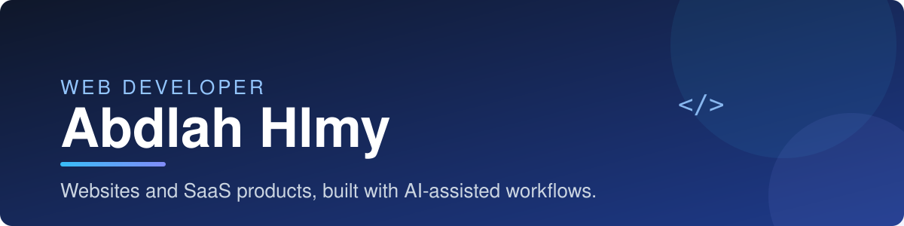

  

  I build websites and SaaS products with Next.js and Supabase, 
  and use AI tools to move faster from idea to a working product.

## What I do

<table>
  <tr>
    <td width="33%" valign="top">
      <h3>Websites</h3>
      Business and landing sites with a clear structure, built to read well on mobile.
    </td>
    <td width="33%" valign="top">
      <h3>SaaS products</h3>
      Web apps built with Next.js and Supabase.
    </td>
    <td width="33%" valign="top">
      <h3>AI-assisted workflow</h3>
      AI tools help me prototype and ship faster.
    </td>
  </tr>
</table>

## Tools

      

## Selected work

Personal and practice projects.

<table>
  <tr>
    <td width="50%" valign="top">
      <h3><a href="https://brainwave-two-rust.vercel.app">BrainWave</a></h3>
      Landing page build. <a href="https://brainwave-two-rust.vercel.app">Live demo</a> · <a href="https://github.com/abdlah-hlmy/BrainWave">Code</a>
    </td>
    <td width="50%" valign="top">
      <h3><a href="https://clone-applesite.vercel.app">Clone-AppleSite</a></h3>
      Product page practice build. <a href="https://clone-applesite.vercel.app">Live demo</a> · <a href="https://github.com/abdlah-hlmy/Clone-AppleSite">Code</a>
    </td>
  </tr>
  <tr>
    <td width="50%" valign="top">
      <h3><a href="https://github.com/abdlah-hlmy/JSM_Banking">JSM_Banking</a></h3>
      Banking app interface built with Next.js. <a href="https://github.com/abdlah-hlmy/JSM_Banking">Code</a>
    </td>
    <td width="50%" valign="top">
      <h3><a href="https://naqaa-cleaning.vercel.app">Naqaa</a></h3>
      
موقع تجريبي لشركة تنظيف سعودية، مبني بالعربي (RTL) على Next.js

      <a href="https://naqaa-cleaning.vercel.app">Live demo</a> · <a href="https://github.com/abdlah-hlmy/Naqaa">Code</a>
    </td>
  </tr>
</table>

## Get in touch

